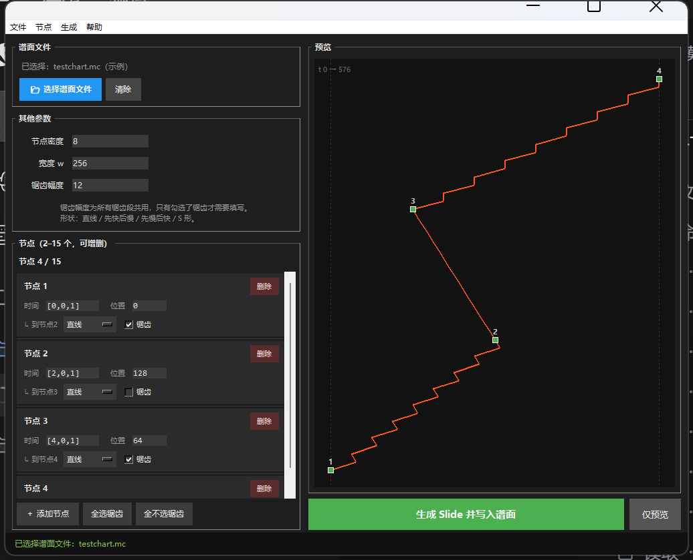

# Malody Slide 生成器

> 为音游 [Malody](https://malody.net/) 谱面设计的 **Slide（滑条）曲线插值工具**。

你只需要给出几个关键控制点和每段想要的缓动形状，工具就会自动算出并批量生成平滑的细分折线段（seg），
直接写进 `.mc` 谱面文件——不用再在制谱器里一条一条手点。

提供 **PC 版**与 **安卓版**，两端**共用同一份算法源码**，因此算出的结果逐字节一致。

<p>
  
  
  
  
</p>

---

## 📥 下载

前往 **[Releases 页面](https://github.com/bdlfy114514/Malody-Slide-Generator/releases)** 下载：

| 你的设备 | 下载哪个 | 说明 |
|---|---|---|
| **安卓手机** | `SlideGenerator-v1.2.apk` | 直接安装即用，无需任何额外环境 |
| **电脑（Windows / macOS / Linux）** | `SlideGenerator-PC-v1.2.zip` | 解压后运行 Python 脚本，需要电脑已装 Python |

> 两个都是最新 1.2 版，功能与算法完全一致，选你习惯的平台就行。

---

## 目录

- [电脑（PC）版](#电脑pc版)
- [安卓版](#安卓版)
- [参数怎么填](#参数怎么填)
- [工作原理](#工作原理)
- [从源码构建](#从源码构建)
- [测试](#测试)
- [常见问题](#常见问题)
- [许可证](#许可证)

---

## 电脑（PC）版

### 第一步：确认电脑上有 Python

按 `Win + R`，输入 `cmd` 回车，然后输入：

```bat
python --version
```

- 显示出 `Python 3.8.0` 或更高的版本号 → 可以了，跳到第二步。
- 提示"不是内部或外部命令" → 需要先装 Python：
  1. 打开 <https://www.python.org/downloads/> 下载最新版；
  2. 安装时**务必勾选最下面的 `Add Python to PATH`**（这一步忘了会一直报错）；
  3. 装完后**重新打开** cmd，再执行一次 `python --version` 确认。

> macOS / Linux 一般自带 Python 3。Linux 上如果报 `No module named tkinter`，
> 执行 `sudo apt install python3-tk` 即可（本工具只用标准库，不需要 pip 装任何东西）。

### 第二步：解压

把 `SlideGenerator-PC-v1.2.zip` 解压到任意文件夹，你会看到：

```
SlideGenerator-PC-v1.2\
├─ run.bat                   ← Windows 用户双击这个
├─ start.bat                 ← 同上（英文名备用，run.bat 双击没反应时用它）
├─ slide_generator_v1_2.py   ← 主程序
├─ slide_core.py             ← 算法核心（必须和主程序放在一起）
└─ 使用说明.md               ← 详细说明
```

> ⚠️ **两个 `.py` 文件必须待在同一个文件夹里**，不要只把主程序单独拎出来。

### 第三步：运行

- **Windows**：双击 `run.bat`（若没反应就双击 `start.bat`）。
- **其他系统 / 或 bat 没反应**：在该文件夹里打开终端，执行
  ```bash
  python slide_generator_v1_2.py
  ```
  （macOS / Linux 用 `python3 slide_generator_v1_2.py`）

界面长这样：



### 第四步：使用

1. 点 **📂 选择谱面文件**，在弹出的系统文件对话框里选中你的 `.mc` 谱面。
   - **不选也可以**：此时只预览、不写文件，适合反复调形状。
2. 填 **节点**：「时间」填 `[拍,线,细分]`，「位置」填 `0–256`。
3. 每个节点下方选 **形状**，需要锯齿就勾上 **锯齿**（也可用「全选锯齿 / 全不选锯齿」批量操作）。
4. 填 **节点密度**、**宽度 w**；只要有任意一段勾了锯齿，就必须填 **锯齿幅度**。
5. 点 **生成 Slide 并写入谱面**（快捷键 `Ctrl+Enter`）。只想看效果就点 **仅预览**。

### 快捷键

| 快捷键 | 作用 |
|---|---|
| `Ctrl + O` | 选择谱面文件 |
| `Ctrl + N` | 添加节点 |
| `Ctrl + Enter` | 生成并写入 |

### 写入行为（重要）

- 写入的是**你选中的那个文件本身**（原地修改），不会另存为新文件。
- 写入前自动备份为 `你的谱面.mc.bak`；若该备份已存在，会顺延为 `.mc.bak.1`、`.mc.bak.2`…
  **永远不会覆盖你之前的备份**。
- 插入是**插入式**的：只在首个 `"note":[` 之后插入生成的 Slide，**不动文件里其它任何内容**。
- 若文件里找不到 `"note":[` 标记，会**报错并中止**，绝不改动文件。

### 功能一览

- ✅ 节点 **2–15 个**，可动态增删
- ✅ **4 种缓动形状**，每段独立选择
- ✅ **锯齿按段独立开关**（不再是整条 Slide 全局加锯齿），互不影响
- ✅ 预览**会真的画出锯齿**，并标注各节点序号
- ✅ **原生文件对话框**，不需要手动复制粘贴路径
- ✅ 自动 `.bak` 备份 + 插入式写入，不怕写坏谱面

---

## 安卓版

### 安装

1. 下载 `SlideGenerator-v1.2.apk`。
2. 传到手机上点击安装。系统可能提示"未知来源应用"，需在设置里允许该来源安装。
3. 如果提示"应用未安装"，请确认手机是 **64 位 ARM** 架构（2015 年后的绝大多数手机都满足）。

**系统要求**：Android 7.0 (API 24) 及以上。

> 本 APK 使用调试密钥签名，**仅供个人侧载安装，不能上架应用商店**。

### 使用

1. 打开 App，点 **[📁 选择谱面文件]**，在系统文件管理器里找到并选中你的 `.mc` 谱面
   （Malody 谱面通常在 `/data/malody/beatmap` 或手机存储的 Malody 目录下）。
2. 填节点、选形状、勾锯齿，操作逻辑和 PC 版完全一致。
3. 点 **[生成 Slide]** 写入。

### 与 PC 版的细微差别

受安卓系统限制，「下载」目录等由系统托管的位置不允许应用在其中新建同级文件，大多时候Malody所在目录也无法写入。
此时 `.bak` 备份会自动存到系统**「下载」目录**。
**无论哪种情况，都会先完成备份再改写原文件。**


---

## 参数怎么填

### 1. 时间：`[a, b, c]`

音游用节拍定位，时间必须写成 3 个整数：

| 字段 | 含义 |
|---|---|
| `a` | **绝对拍数**（从 0 拍开始算） |
| `b` | 当前拍内的**第 b 条节拍线**（正拍点处为第 0 条） |
| `c` | 当前拍被**均匀分成 c 份**（节拍细分数） |

示例：`[4, 1, 4]` = 第 4 拍，这一拍被分成 4 份，取第 1 条线。

> ⚠️ 制谱器里拍数从 1 开始标，但谱面文件里从第 **0** 拍开始，
> 所以填 `a` 时要用**制谱器显示的拍数减 1**。

### 2. 位置（X 坐标）：`0 – 256`

| 值 | 位置 |
|---|---|
| `0` | 屏幕最左 |
| `128` | 屏幕正中 |
| `256` | 屏幕最右 |

### 3. 其它参数

| 参数 | 说明 |
|---|---|
| **节点密度 (density)** | 正整数。越大切得越细、越平滑，谱面文件也越大。例如想要制谱器里呈现 "`1/8`"（32 分音符）的节点间隔，密度填 `8` 即可。 |
| **宽度 (w)** | Slide 在游戏里的显示宽度，单位与 X 相同，`256` 为全宽。 |
| **锯齿幅度 (amplitude)** | 整数（可正可负，可为 0）。**所有锯齿段共用同一个幅度**，常见取值 3–15。 |

### 4. 形状类型

每两个相邻节点之间为一段，**段数 = 节点数 − 1**，每段独立选形状：

| 代号 | 名称 | 效果 |
|---|---|---|
| `s` | 直线 Straight | 匀速从上一节点到下一节点 |
| `si` | 正弦缓动 Sine In | 先快后慢：出发极快，接近节点时减速卡点 |
| `so` | 反余弦缓动 Sine Out | 先慢后快：出发缓慢，随后加速冲出 |
| `b` | 贝塞尔 Bezier | 慢-快-慢，两头慢中间快（即 S 形） |

### 5. 锯齿（serrated）的精确含义

勾选锯齿的段，其**段内偶数序号的 seg**（第 1、3、5… 个）会被抬高 `amplitude`。
**每段从自己的起点重新计数**，所以相邻的锯齿段不会互相干扰，未勾选的段保持完全平滑。

---

## 工作原理

```
PC 版：    slide_generator_v1_2.py ──导入──> slide_core.py
安卓版：   index.html ──JS──> MainActivity.kt ──Chaquopy──> slide_core.py
                                       ↑
                 文件读写全部在 Kotlin 侧（SAF 的 content:// URI）
```

`src/main/python/slide_core.py` 是**唯一**的算法实现，纯标准库、无副作用：

| 函数 | 作用 |
|---|---|
| `timetrans(t)` | `[拍,线,细分]` → 绝对时间（1 拍 = 96 单位） |
| `transtime_rev(t)` | 绝对时间 → `[拍,线,细分]` 文本 |
| `_shape_x(shape, X1, X2, k)` | 按缓动形状求进度 `k` 处的 X 坐标 |
| `drawslide(...)` | 核心：生成 Slide 文本 + 预览点 |
| `generate(params_json)` | 给安卓用的 JSON 桥接（含全部参数校验） |

PC 版**不复制**这份算法，而是直接导入它。仓库里的自动化测试会拿同一组参数分别跑两端的
完整链路，逐字节比对生成的 Slide 文本，确保永远不会分叉。

---

## 从源码构建

### PC 版

无需构建，直接运行：

```bash
python slide_generator_v1_2.py
```

### 安卓版

需要 JDK 17、Android SDK（`platforms;android-34`、`build-tools;34.0.0`）。

```bash
cd android
# 先按模板生成本机配置（这两个文件含各人电脑的绝对路径，不入库）
copy gradle.properties.example gradle.properties
copy local.properties.example local.properties   # 填好里面的 sdk.dir
./gradlew assembleRelease      # 或 assembleDebug
```

产物在 `android/app/build/outputs/apk/`。

**版本矩阵**：Android Gradle Plugin 8.5.2 · Gradle 8.7 · Kotlin 1.9.24 ·
Chaquopy 17.0.0 · Python 3.12 · compileSdk/targetSdk 34 · minSdk 24 ·
ABI `arm64-v8a` + `x86_64`（Chaquopy 的 Python 3.12 不提供 32 位 ARM 运行时）。

改版本号：编辑 `android/app/build.gradle` 里的 `versionCode` / `versionName`。

细节见 [README_ANDROID.md](README_ANDROID.md)。

---

## 测试

仓库自带两个 PC 版自动化测试：冒烟测试会真实启动 Tk 界面、程序化驱动增删节点与生成；
端到端测试模拟"用户点按钮"的完整流程（拦截弹窗，不干扰桌面）。

```bash
python .toolchain/test_desktop_v1_2.py     # 41 项：界面/校验/对拍/锯齿语义/写回备份
python .toolchain/test_desktop_e2e.py      # 11 项：端到端完整流程
```

覆盖内容：界面构建、节点增删与 15 个上限、参数校验报错、**两端算法逐字节对拍**、
分段锯齿语义（段内偶数序号、每段独立计数、不被相邻段影响）、预览锯齿、
写回 `.mc` 与 `.bak` 顺延、无 `"note":[` 标记时中止且不改文件。

> 只想快速验一下算法（不用开界面）：
> ```bash
> python -c "import sys,json; sys.path.insert(0,'src/main/python'); import slide_core as s; print(json.loads(s.generate(json.dumps({'w':256,'density':8,'nodes':[{'t':[0,0,1],'x':0},{'t':[2,0,1],'x':256}],'segs':[{'shape':'s','serrated':True}],'amplitude':'10'})))['ok'])"
> ```
> 注意 `generate()` 返回的是 **JSON 字符串**，要先 `json.loads` 再取字段。

---

## 常见问题

<details>
<summary><b>双击 run.bat 闪一下就没了 / 报错</b></summary>

说明脚本运行出错。在该文件夹里按住 `Shift` 右键 → 「在此处打开 PowerShell 窗口」（或打开 cmd 后 `cd` 过去），执行：

```bat
python slide_generator_v1_2.py
```

这样错误信息会留在窗口里，方便排查。最常见的原因是没装 Python，或安装时忘了勾 `Add Python to PATH`。
</details>

<details>
<summary><b>提示 "No module named tkinter"</b></summary>

Linux 上常见，执行 `sudo apt install python3-tk`。
Windows 官方安装包自带 tkinter，若报这个错说明 Python 安装不完整，建议重新安装并勾选所有组件。
</details>

<details>
<summary><b>提示找不到算法核心 slide_core.py</b></summary>

`slide_core.py` 必须和 `slide_generator_v1_2.py` 放在**同一个文件夹**里。
如果你是从仓库里单独拷了主程序出来，记得把这个文件一起拷上。
</details>

<details>
<summary><b>写了但游戏里没变化</b></summary>

确认选中的是**正确的 `.mc` 文件**，并且生成后用制谱器重新加载了谱面。
原文件已被原地修改，随时可以用同名的 `.bak` 备份还原。
</details>

<details>
<summary><b>.bak 会覆盖我上一个备份吗？</b></summary>

不会。已存在 `x.mc.bak` 时会依次使用 `x.mc.bak.1`、`x.mc.bak.2`… **永不覆盖**。
</details>

<details>
<summary><b>锯齿幅度填多少合适？</b></summary>

它是 X 方向的偏移量（坐标系宽 0–256）。常见取值 3–15，具体看你想要的观感，可以边调边看预览。
</details>

<details>
<summary><b>和 1.1 老版本相比有什么区别？</b></summary>

1.2 把节点上限从 5 提到 **15**，把"全局锯齿"改成**按段独立锯齿**，
改用**原生文件对话框**（不用再复制粘贴路径），预览也会画出锯齿。
只用一个节点段并全局勾锯齿时，**1.2 的结果与 1.1 完全一致**。

> 仓库里的 `slide_generator_v1.1.py` 仅为历史存档，其算法已与 1.2 分叉，
> **新用户请直接使用 1.2**。
</details>

---

## 许可证

[MIT License](LICENSE) © 2026 bdlfy114514

本项目代码由 AI 辅助生成（vibe coding）。
